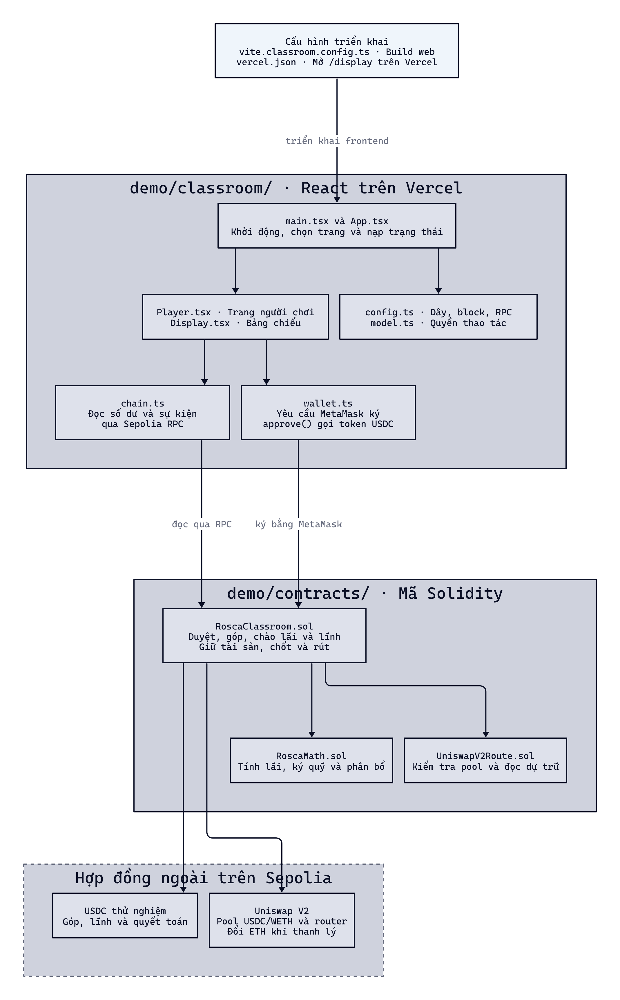
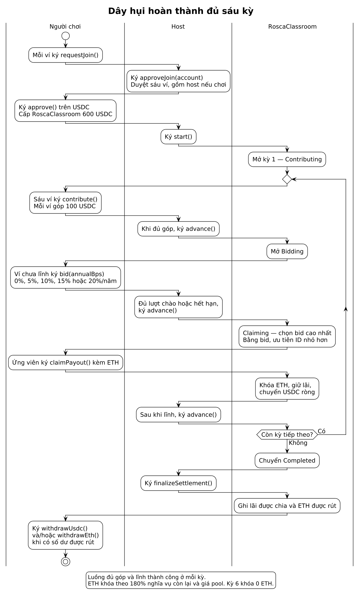
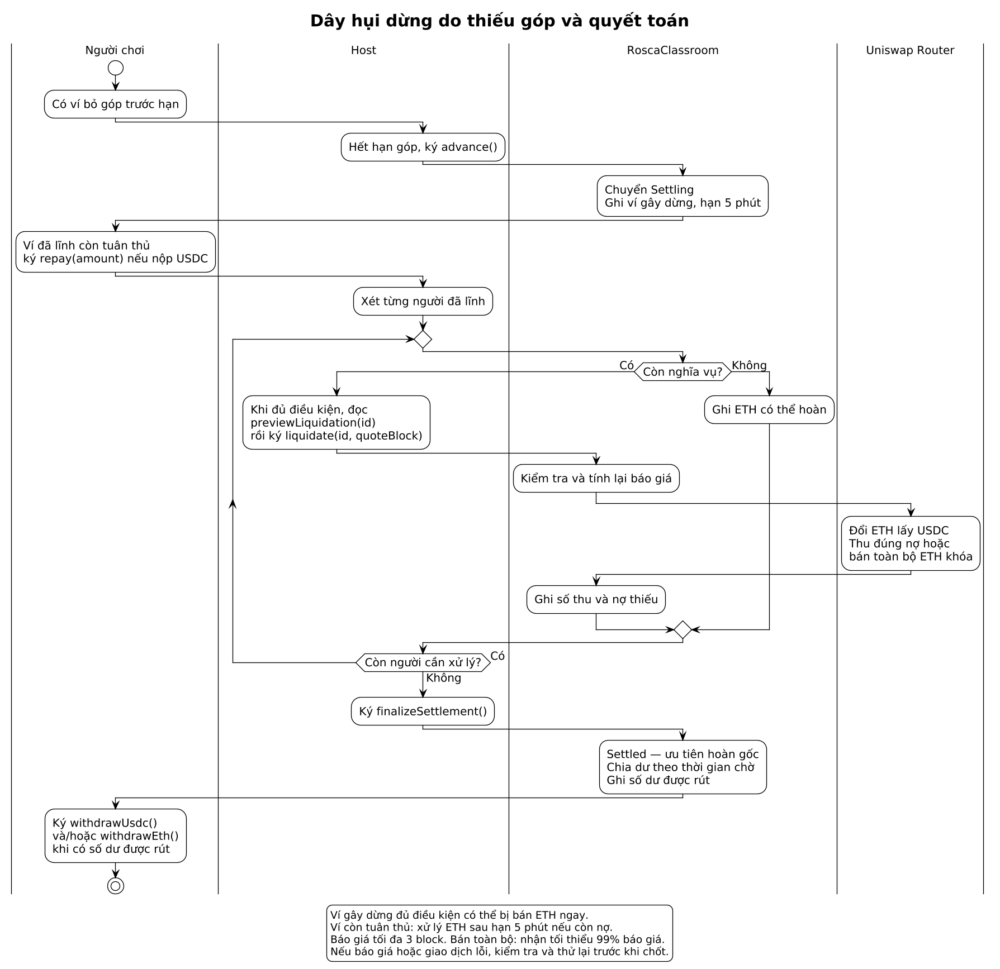

# Hụi Chain lớp học · Sepolia

Bản demo lớp học cho sáu người dùng sáu ví chơi dây hụi bằng USDC và ETH **testnet**. Host cũng là một người chơi. Frontend tĩnh có tab người chơi và tab bảng chiếu; không có bot, backend hoặc khóa ví trên server.

> Mỗi dây hụi là một contract riêng trên Sepolia; contract đã kết thúc không thể reset. Contract năm người cũ tại `0xa28B310Cc345E693bc468829b08e1f08a50d6c47` là bản lịch sử, không dùng với frontend sáu người. Không dùng tiền thật. Tỷ lệ ký quỹ 180% chỉ là tham số demo, không bảo đảm tránh mất gốc.

## Kiến trúc và luồng demo

### Kiến trúc mã nguồn

Frontend trong `demo/classroom/` chạy trên Vercel. `App.tsx` điều phối trang người chơi và bảng chiếu, `chain.ts` đọc dữ liệu từ Sepolia, còn `wallet.ts` chuẩn bị giao dịch để MetaMask ký. `RoscaClassroom.sol` là hợp đồng điều phối dây, giữ tài sản và quyết toán. Hai thư viện Solidity xử lý phép tính và kết nối pool Uniswap V2.



### Hoàn thành đủ sáu kỳ

Mỗi kỳ, sáu ví góp 100 USDC mỗi ví. Người chưa lĩnh chào lãi, ứng viên thắng ký lĩnh và gửi ETH ký quỹ. Sau kỳ 6, host chốt phân bổ và từng thành viên ký rút tài sản. Có thể xem lại dây đã hoàn thành đủ sáu kỳ, được triển khai ở block `11969004`. [Bảng chiếu của dây đã hoàn thành](https://huichain-demo.vercel.app/display?wire=0x6e8751Ca3b0a9Dc8F6A2E3139A57C3DE65290C6A&block=11969004) · [Giao dịch chốt trên Sepolia Etherscan](https://sepolia.etherscan.io/tx/0xb1098e66e2a83771131641a2013f71f67d23259782a3b1bec9e18901b70d61fd)



### Bỏ góp và quyết toán

Nếu có người thiếu góp khi hết hạn, host chuyển dây sang quyết toán. Người đã lĩnh còn tuân thủ có thể nộp USDC trước hạn. Host có thể thanh lý ETH đủ điều kiện qua router Uniswap V2, rồi chốt phân bổ. Hợp đồng ưu tiên hoàn gốc cho người chưa lĩnh.



## Chạy và kiểm thử trên máy

Yêu cầu Node.js 22 trở lên. Trong PowerShell:

```powershell
cd .\demo
npm.cmd ci
npm.cmd run test:unit
npm.cmd run test:contract
npm.cmd run export:abi
npm.cmd run build
```

Kiểm tra đúng pool/router Sepolia ngay trước khi triển khai:

```powershell
$env:COLLATERAL_RATIO_BPS='18000'
npm.cmd run check:route
```

Kết quả có `"usable": true` mới được tiếp tục. Lần kiểm tra ngày 22/10/2026 ở block `11968824` trả về `usable=true`; phải kiểm tra lại ngay trước khi triển khai vì thanh khoản và quote thay đổi. Bằng chứng ở `demo/.runtime/route-evidence.json` chỉ lưu local, không đưa lên GitHub.

Để xem khung web local sau khi đã có địa chỉ contract và block triển khai:

```powershell
$env:VITE_WIRE_ADDRESS='0x...dia_chi_contract...'
$env:VITE_DEPLOY_BLOCK='...so_block_deploy...'
$env:VITE_SEPOLIA_RPC_URL='https://ethereum-sepolia-rpc.publicnode.com'
npm.cmd run dev
```

Mở `http://localhost:5173/` cho người chơi và `http://localhost:5173/display` cho bảng chiếu. Không cần tệp `.env`; frontend chỉ dùng ba biến công khai trên. Tránh đưa RPC key riêng vào Vite vì biến `VITE_` sẽ hiện trong bundle.

## Triển khai contract lên Sepolia

Để tạo một dây sáu người mới, thực hiện bằng Remix IDE và ví host, **không gửi private key cho repo/web**:

1. Chạy `test:contract`, `export:abi`, `check:route` như trên; xác nhận route còn dùng được. Đọc mã nguồn `demo/contracts/RoscaClassroom.sol` và hai thư viện `RoscaMath.sol`, `UniswapV2Route.sol` trước khi ký triển khai.
2. Tạo workspace Remix, đưa ba tệp Solidity đó vào thư mục `contracts`. Chọn compiler `0.8.28`, bật optimizer 200 runs, cho Remix tải import OpenZeppelin chính thống. Chọn môi trường `Injected Provider` và mạng Sepolia.
3. Triển khai `RoscaClassroom` với bốn tham số lần lượt: `host_` là ví host của anh, `token` = `0x1c7d4b196cb0c7b01d743fbc6116a902379c7238`, `v2Pair` = `0x72e46e15ef83c896de44b1874b4af7ddab5b4f74`, `v2Router` = `0xee567fe1712faf6149d80da1e6934e354124cfe3`.
4. Ghi lại **địa chỉ contract mới, tx hash và block number triển khai** từ Etherscan. Đọc lại `host`, `collateralRatioBps = 18000`, `usdc`, `pair`, `router`, `memberCount = 0` và `POT = 600000000` để xác nhận đúng. Chỉ sau đó mới cấu hình web.

### Chơi một dây mới mà không cần redeploy frontend

Trên trang người chơi, tìm mục **Mở dây hụi khác**, nhập địa chỉ contract mới và **block của giao dịch triển khai**, rồi bấm **Mở dây mới**. Web chuyển sang liên kết dạng `/?wire=0x...&block=...`; gửi nguyên liên kết đó cho các bạn. Tab **Bảng chiếu** giữ cùng `wire` và `block`. Không cần đổi biến Vercel hay cấp quyền ví host chỉ để chuyển liên kết.

Lưu liên kết dây cũ trước khi chuyển; người chơi cần mở lại đúng contract cũ để rút USDC/ETH sau quyết toán hoặc thu hồi allowance. Địa chỉ mặc định trong Vercel vẫn mở qua `/`. Nếu muốn một dây khác thành mặc định, khi đó mới sửa `VITE_WIRE_ADDRESS` và `VITE_DEPLOY_BLOCK` rồi redeploy frontend. Web chỉ kiểm tra một số hằng số của contract; host vẫn phải đối chiếu mã nguồn và địa chỉ trên Sepolia trước khi mời người khác ký hoặc approve.

Contract không có nút bùng giả: người chơi bỏ góp và host chuyển bước **sau đúng hạn onchain 5 phút**. Host phải tự bấm chuyển bước, thanh lý và chốt; không có keeper tự động. Dây dừng khi có người không góp, không sinh dây con. Lãi chào vẫn tính theo tối đa năm kỳ quy ước, mỗi kỳ 30 ngày (lượt đầu là 150 ngày), **không** theo 5 phút demo.

## Mô phỏng ABM

Thư mục [`abm/`](abm/) chứa mô hình sáu người theo dõi từng thành viên qua các kỳ góp, chào lãi, lĩnh, bỏ góp và quyết toán. Mô phỏng dùng kỳ 30 ngày và cửa sổ giá ETH lịch sử để đo số USDC gốc được hoàn khi dây dừng.

Trong bộ thử theo giá đóng cửa, **250%** là mức ký quỹ thấp nhất trên lưới đã thử đạt tiêu chí hoàn đủ gốc, với **0 ca mất gốc trong 839.376 lượt**. Khi dùng giá đáy ngày 18/06/2022, ở cùng mức 250% có **22/825 lượt mất gốc**. Mức **180%** là cấu hình riêng của demo Sepolia.

[Cách chạy ABM và dashboard Streamlit](abm/README.md) · [Kết quả quét ký quỹ](abm/results/phase-b-upper-2022-2026-verified/report.md) · [Kiểm thử theo giá đáy](abm/results/phase-b-crash-15-20/report.md) · [Lịch sử commit ABM](https://github.com/CuongTran17/huichain_demo/commits/abm-history/)

## Đưa frontend lên Vercel khi có repo GitHub mới

Trong Vercel chọn **Root Directory = `demo`**, Framework = Vite, Install = `npm ci`, Build = `npm run build`, Output = `dist`. Ba Environment Variables **công khai** là `VITE_WIRE_ADDRESS`, `VITE_DEPLOY_BLOCK`, `VITE_SEPOLIA_RPC_URL`. Bản build sáu người **từ chối** địa chỉ contract năm người cũ. Để site đang chạy không bị gián đoạn, giữ bản frontend năm người đang phục vụ địa chỉ cũ, diễn tập bản sáu người ở môi trường riêng; chỉ đổi bản build và địa chỉ/block sang contract sáu người **cùng một đợt** sau khi kiểm tra sáu ví và bảng chiếu. Vercel chỉ phục vụ file tĩnh; không triển khai backend hoặc bot. Không đặt private key hay RPC key bí mật vào biến `VITE_`.

## Diễn tập trong lớp

1. Host mở `/` bằng ví Sepolia của mình và `/display` ở tab chiếu. Năm bạn còn lại mở `/` trên máy riêng, kết nối Sepolia. Mỗi ví cần USDC Sepolia để góp 100 USDC mỗi kỳ (tổng tối đa 600), ít ETH để trả gas; người thắng sớm cần thêm ETH ký quỹ theo quote pool lúc lĩnh.
2. Cả sáu ví gửi “Xin tham gia”; host xác nhận đúng người trong lớp rồi duyệt từng ví. ID cấp theo thứ tự duyệt, hòa bid thì ID thấp hơn thắng. Host cũng phải xin tham gia và tự duyệt mình. Ví thứ bảy không thể được duyệt.
3. Sau khi duyệt, mỗi người ký **approve đúng 600 USDC** một lần. Approval không chuyển tiền. Host xem checklist sáu ví rồi bấm bắt đầu.
4. Từng người bấm góp 100 USDC. Host chuyển sang chào lãi khi đủ sáu; người chưa lĩnh chọn 0%, 5%, 10%, 15% hoặc 20% một năm. Host chuyển sang lĩnh; ứng viên kiểm tra lãi giữ, USDC ròng và ETH cần khóa rồi ký claim. Lượt đầu ở mức 20%: quỹ 600, lãi giữ 41,095890, nhận ròng 558,904110 và còn nghĩa vụ 500 USDC.
5. Host chuyển kỳ tiếp; người đã lĩnh vẫn góp 100 USDC nhưng không chào lại. Nếu ai không góp, phải chờ hết hạn 5 phút trên Sepolia rồi host bấm chuyển bước. Trong quyết toán, người không gây bùng có 5 phút để trả nghĩa vụ; host bán ETH đủ điều kiện rồi chốt. Người chơi rút USDC/ETH được phân bổ.

Nếu dây dừng sớm, **allowance còn lại không tự mất**. Người chơi có thể dùng giao diện ví/Etherscan để giảm hoặc thu hồi quyền USDC cho contract cũ. Chỉ làm với đúng địa chỉ contract của dây.

## Giới hạn

- Host xét duyệt người ngoài hệ thống; contract không chống một người dùng nhiều ví.
- Chào lãi công khai trên chain, không phải đấu giá kín.
- Giá Uniswap Sepolia khác thị trường thật; quote, trượt giá và tính thanh khoản có thể đổi trước khi transaction được xác nhận. Claim/thanh lý có thể revert; làm mới dữ liệu và thử lại.
- ETH spot hiển thị không phải số USDC chắc chắn thu được khi bán. Không có Chainlink, margin call, bảo lãnh đủ 100%, kiểm toán bảo mật hoặc triển khai mainnet.
- Sáu ví thật trên Sepolia vẫn cần thử ít nhất một vòng góp, chào, lĩnh và một ca quyết toán trước buổi học. Các test local và build **không thay thế** kiểm thử đó.

[Đặc tả năm người lịch sử](docs/superpowers/specs/2026-10-19-five-wallet-classroom-sepolia-design.md) · [Kế hoạch năm người lịch sử](docs/superpowers/plans/2026-10-19-five-wallet-classroom-sepolia.md)
